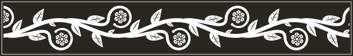
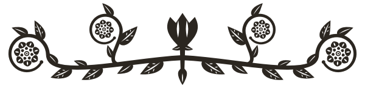
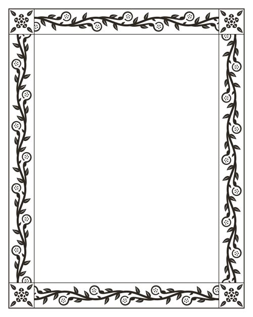
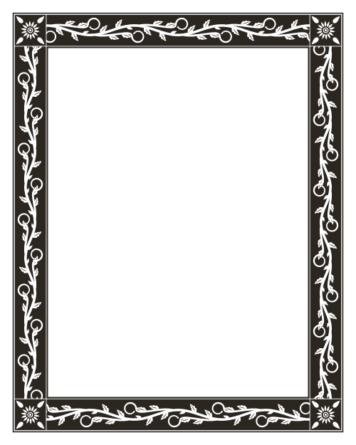
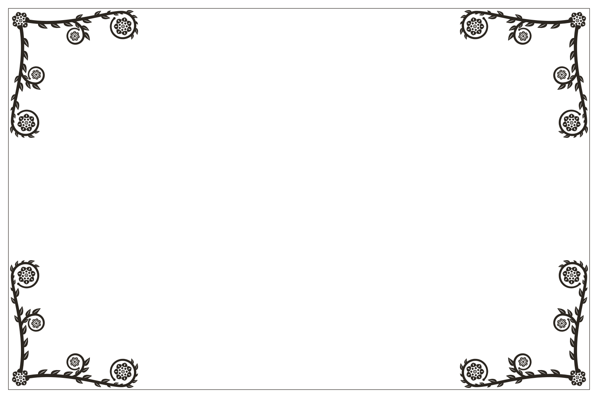

# alembic-ornaments

Seeded woodcut ornaments and frames, drawn as SVG. Give it a preset and a
number, and it grows a flourish: vines, lilies, rosettes and acanthus leaves,
fitted together so nothing overlaps. The same seed always draws the same
picture, so you can store two values instead of an image.

<picture>
  <source media="(prefers-color-scheme: dark)" srcset="docs/vine-dark.svg">
  
</picture>

Made for [Alembic](https://alembic.space). Try every preset and seed in the
[ornament playground](https://alembic.space/ornaments).

- **Tiny and dependency-free.** Pure TypeScript that runs anywhere: browser, Node, edge, build time.
- **Deterministic.** `{ preset, seed }` is the whole ornament.
- **Fits any box.** Wrap a component in `<Framed>` and the frame measures it, fits it and follows it as it resizes.
- **Ink-agnostic.** Drawn in `currentColor`, so it takes the colour of the text around it.
- **React components** included, optional.

```sh
npm install @lauriparonen/alembic-ornaments
```

## Usage

### A frame round any component

```tsx
import { Framed } from '@lauriparonen/alembic-ornaments/react'

<Framed preset="border" seed={4}>
  <h3>On distillation</h3>
  <p>A good essay vivifies its writer as much as its reader.</p>
</Framed>
```

`<Framed>` is a `div` that measures itself, draws a frame to its exact size
and pads its children clear of it. Size it however you like (by its content,
a grid, `width: 100%`, `aspect-ratio`) and resize it freely: the frame
follows, with more vine along a longer side rather than a stretched one.

- `size` is the room the frame takes on each side, in px (default `32`). It
  stays the same on a 300px card and a 1200px hero. A box too small for the
  size asked for gives the frame at most 30% of its shorter side.
- The padding belongs to the frame. Put any padding of your own on the
  content inside.
- It takes the text colour: set `color` to tint it.
- Any other `div` props (`className`, `style`, `onClick`…) pass through.

On the server the box has no size yet, so the frame appears when the page
hydrates. The padding is there from the start, so nothing moves.

### Dividers and endpieces

```tsx
import { Ornament } from '@lauriparonen/alembic-ornaments/react'

<Ornament preset="vine" seed={7} />                       {/* fills the column */}
<Ornament preset="sprig" seed={11} style={{ width: 120 }} />
```

`<Ornament>` keeps its own proportions: give it a width and the height
follows.

### Without React

```ts
import { generateOrnament, fitFrame } from '@lauriparonen/alembic-ornaments'

const { svg } = generateOrnament({ preset: 'garland', seed: 42 })
element.innerHTML = svg

const frame = fitFrame({ preset: 'corners', seed: 9, size: 32 }, box.clientWidth, box.clientHeight)
```

`svg` is a complete `<svg>` string with a `viewBox`. Scale it with CSS like
any other image. React is an optional peer dependency: if you only use the
core, you don't need it.

## Presets

| | preset | |
|---|---|---|
| <picture><source media="(prefers-color-scheme: dark)" srcset="docs/vine-dark.svg"></picture> | `vine` | running scroll between rules |
| <picture><source media="(prefers-color-scheme: dark)" srcset="docs/frieze-dark.svg"></picture> | `frieze` | the vine cut white from a black block |
| <picture><source media="(prefers-color-scheme: dark)" srcset="docs/garland-dark.svg"></picture> | `garland` | a lily between two sweeping arms |
| <picture><source media="(prefers-color-scheme: dark)" srcset="docs/sprig-dark.svg"></picture> | `sprig` | a small flower to end on |

`PRESETS` lists them, each with a `span` (its natural width as a share of a
text column) and a fixed `aspect` (width ÷ height). The aspect never depends
on the seed, so you can reserve space before drawing anything.

## Frames

<p>
  <picture><source media="(prefers-color-scheme: dark)" srcset="docs/frame-border-dark.svg"></picture>
  <picture><source media="(prefers-color-scheme: dark)" srcset="docs/frame-block-dark.svg"></picture>
  <picture><source media="(prefers-color-scheme: dark)" srcset="docs/frame-corners-dark.svg"></picture>
</p>

`border`, `block` and `corners`, as `<Framed>` draws them round a 360×240
card. Frames share flowers and leaves with the presets: the same seed gives
the same family of motifs.

There are two ways to size one:

- **In pixels**, for interfaces: `fitFrame(params, width, height)` takes a
  `size` (the room it takes on each side) and draws to that box, however big.
  This is what `<Framed>` uses.
- **In proportion**, for print-like pages where the frame grows with the
  page: `generateFrame(params, aspect)` takes a `scale` from
  `FRAME_SCALE_MIN` (0.6) to `FRAME_SCALE_MAX` (1.6), relative to the box.

```ts
import { fitFrame, generateFrame } from '@lauriparonen/alembic-ornaments'

const fitted = fitFrame({ preset: 'border', seed: 4, size: 32 }, 800, 600) // fitted.inset ≈ 32
const proportional = generateFrame({ preset: 'border', seed: 4, scale: 1 }, 4 / 3)
```

To keep content clear of a proportional frame, `frameInset` says how far in
it has to start, as fractions of the box:

```ts
import { frameInset } from '@lauriparonen/alembic-ornaments'

const { x, y } = frameInset('border', 4 / 5)
// x of the width on the left and right, y of the height top and bottom
content.style.cssText = `position: absolute; inset: ${y * 100}% ${x * 100}%`
```

By default content clears every bit of ink. A `corners` frame can also be
told to clear only its edges (`frameInset(preset, aspect, scale, 'edges')`,
or `clear="edges"` on `<Framed>`), which lets centred content sit in among
the corner sprays.

## Storing ornaments

Store the params, not the SVG:

```ts
import { generateOrnament, normalizeParams } from '@lauriparonen/alembic-ornaments'

const saved = JSON.stringify({ preset: 'vine', seed: 7 })
// …later, from untrusted input:
const params = normalizeParams(JSON.parse(saved)) // unknown preset → 'vine', seed → non-negative integer
generateOrnament(params)
```

**The stability promise:** within a major version, the same params draw the
same picture. Every release is tested against snapshots of hundreds of
preset/seed/frame combinations, so a drawing can't change by accident. A
change to an existing preset's look will be a major version. New presets
arrive in minor versions.

The promise covers the drawing, not the exact bytes. JavaScript engines can
disagree in the last bit of a trigonometric result, so Node and a browser may
emit slightly different numbers for the same ornament. If you render on the
server and hydrate on the client, the React components handle this for you.

## API

### `@lauriparonen/alembic-ornaments`

| | |
|---|---|
| `generateOrnament(params)` | `{ params, svg, width, height }` for `{ preset, seed }`. Results are cached. |
| `fitFrame(params, width, height)` | A frame `{ preset, seed, size, clear? }` drawn to a box, taking `size` on each side. Adds `inset`: the room it actually takes. `null` for an empty box. |
| `generateFrame(params, aspect)` | A frame `{ preset, seed, scale? }` drawn in proportion to a box of `aspect` (width ÷ height). |
| `ornamentOutline(params)` | The ornament's ink as polygons in its own `width × height` box, for flowing text around it. |
| `frameInset(preset, aspect, scale?, clear?)` | How far content must stay in from a proportional frame's edges: `{ x, y }` as fractions of the box's width and height. |
| `normalizeParams(input)` | Coerces anything into valid `OrnamentParams`. |
| `normalizeFrame(input)` | Coerces into valid `FrameParams`, or `null` for an unknown frame. |
| `normalizeFrameScale(scale)` | Clamps a scale to the allowed range, in steps of 0.05. |
| `presetInfo(id)` | The `PRESETS` entry for a preset. |
| `PRESETS`, `FRAMES` | The available presets and frames, with labels and short descriptions. |
| `DEFAULT_ORNAMENT` | `{ preset: 'vine', seed: 1 }` |

### `@lauriparonen/alembic-ornaments/react`

| | |
|---|---|
| `<Framed preset seed size? clear? …divProps>` | A box with a frame fitted round its children, whatever its size. |
| `<Ornament preset seed className? style? />` | An ornament at its natural proportions. |
| `<OrnamentFrame preset seed scale? aspect className? style? />` | A proportional frame drawn to `aspect`, filling its box. |
| `<OrnamentArt svg className? style? />` | Low-level: renders any generated SVG string, sized by its box. |

The drawings render in a `<div aria-hidden>`, since ornaments are decoration.

## Developing

`npm run demo` serves a page with every component, resizable boxes and a
size slider. `npm run test` runs the tests, drawing snapshots included.

## License

[MIT](LICENSE) © Lauri Paronen
